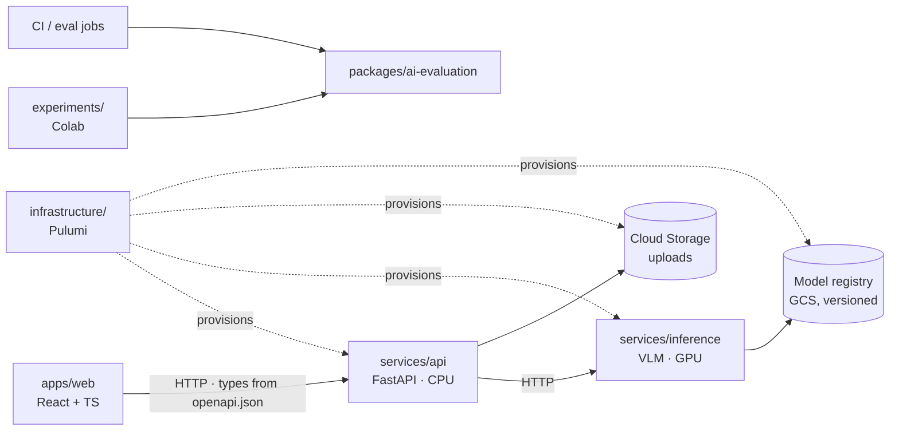

# Architecture overview

## Components and allowed dependencies

- **API and inference are separate services** because they scale and cost differently. The API is
  cheap CPU Cloud Run that scales to zero. Inference needs a GPU, so it has different cold starts,
  quotas and costs.
- **`services/api` has no ML dependencies.** Everything model-specific lives in inference, so the
  API image stays small and fast to deploy.
- **Contracts are generated, not copied.** `services/api/openapi.json` → `apps/web` types
  ([ADR 0003](../decisions/0003-api-contract-via-openapi.md)).
- **Experiments are isolated.** Nothing imports `experiments/`. Production artefacts come from the
  model registry with recorded provenance, never from a notebook.

## Intended MVP request flow (not built yet)

Synchronous to start, because it is the simplest thing that can work:

1. The web app uploads a photo to the API.
2. The API validates it (type, size), strips EXIF, stores it in a private bucket, and calls
   inference with a timeout.
3. Inference returns structured attributes plus the model version.
4. The API persists and returns them, and the web app renders them.

Switch to asynchronous processing (Pub/Sub or Cloud Run Jobs, with polling) **only** if measured
latency or cold starts make the synchronous path unacceptable. That switch needs an ADR.

## Open decisions (each becomes an ADR)

| Decision | Inputs needed |
| --- | --- |
| MVP scope (which wardrobe capabilities first) | product discussion |
| Evaluation dataset(s) and taxonomy | licence checks (see `dataset-management`) |
| Baseline VLM | licence, size, Colab baseline results on our eval set |
| Serving runtime (Transformers vs vLLM, quantisation) | latency/memory on L4 |
| Inference hosting (Cloud Run GPU vs alternatives), region | cost and cold-start measurements |
| Persistence for wardrobe items (Firestore vs Cloud SQL) | data model, query needs |
| Authentication | product scope |
| Frontend hosting | Cloud Run vs Firebase Hosting vs Cloud Storage + CDN |
